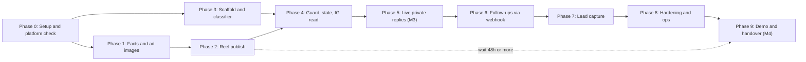

# Insta Growth Kit — Phase-Wise Implementation Plan

> **Inputs:** [problemstatement.md](./problemstatement.md) · [architecture.md](./architecture.md)
> **Goal:** Ship one product → 3 ad images + voiceover → 15s Reel → comment-to-DM bot → follow-up answers → lead sheet → owner handover.
> **Working rule:** Finish and test each phase before starting the next. AI-generated code is a starting point, not proof that it works.

---

## Table of Contents

1. [Plan at a Glance](#1-plan-at-a-glance)
2. [Timeline and Dependencies](#2-timeline-and-dependencies)
3. [Phase 0 — Setup and Platform Verification](#phase-0--setup-and-platform-verification)
4. [Phase 1 — Product Facts and Ad Images (Milestone 1)](#phase-1--product-facts-and-ad-images-milestone-1)
5. [Phase 2 — Reel Production and Publishing (Milestone 2)](#phase-2--reel-production-and-publishing-milestone-2)
6. [Phase 3 — Bot Scaffold and Offline Classifier](#phase-3--bot-scaffold-and-offline-classifier)
7. [Phase 4 — Reply Guard, State and Instagram Read](#phase-4--reply-guard-state-and-instagram-read)
8. [Phase 5 — Live Private Replies (Milestone 3)](#phase-5--live-private-replies-milestone-3)
9. [Phase 6 — Follow-Up Handling via Webhook](#phase-6--follow-up-handling-via-webhook)
10. [Phase 7 — Lead Capture in Google Sheets](#phase-7--lead-capture-in-google-sheets)
11. [Phase 8 — Hardening, Health and Operations](#phase-8--hardening-health-and-operations)
12. [Phase 9 — Demo, Handover and Insights Review (Milestone 4)](#phase-9--demo-handover-and-insights-review-milestone-4)
13. [Definition of Done (Project)](#13-definition-of-done-project)
14. [Risk Checkpoints](#14-risk-checkpoints)
15. [Progress Tracker](#15-progress-tracker)

---

## 1. Plan at a Glance

| Phase | Name | Milestone | Main output | Est. effort |
|-------|------|-----------|-------------|-------------|
| 0 | Setup and platform verification | — | Accounts, Meta app, repo, `platform-notes.md` | 1–2 days |
| 1 | Product facts and ad images | **M1** | `factcard.json`, 3 ad images, voiceover | 1–2 days |
| 2 | Reel production and publishing | **M2** (part) | Public 15s Reel, media ID | 1 day |
| 3 | Bot scaffold and offline classifier | M3 (part) | Worker skeleton, classifier ≥ 25/30 | 2–3 days |
| 4 | Reply guard, state and IG read | M3 (part) | Guard + KV + live comment fetch (read-only) | 2 days |
| 5 | Live private replies | **M3** | Real comment → private reply recording | 1–2 days |
| 6 | Follow-up handling via webhook | M4 (part) | Fact-card answers + handoff | 2 days |
| 7 | Lead capture in Google Sheets | M4 (part) | Apps Script endpoint, outbox, ≥ 10 rows | 1–2 days |
| 8 | Hardening, health and operations | M4 (part) | `/health`, alerts, token check, runbook | 1–2 days |
| 9 | Demo, handover, insights review | **M4** + M2 finish | 60–90s demo, handover, Insights + 3 ideas | 1–2 days |

**Total:** roughly 3–4 weeks part-time (about 14–20 working days).

---

## 2. Timeline and Dependencies

**Parallel work:**
- Phases 1–2 (creative, phone apps) and Phase 3 (offline code) can run side by side once Phase 0 is done.
- Start the **48-hour Insights clock** as soon as the Reel is live in Phase 2. Collect Insights any time after that, and finish in Phase 9.
- If Meta app review is needed (found in Phase 0), submit it early so it runs in parallel with Phases 1–4.

### Suggested calendar (part-time)

| Week | Phases | Checkpoint |
|------|--------|------------|
| Week 1 | 0, 1, start 3 | Fact card approved, 3 ad images done (M1) |
| Week 2 | 2, finish 3, 4 | Reel live, classifier passes 25/30 offline |
| Week 3 | 5, 6, 7 | Real private reply recorded (M3), follow-ups and leads working |
| Week 4 | 8, 9 | Demo video, handover, Insights review (M4) |

---

## Phase 0 — Setup and Platform Verification

**Objective:** Confirm the stack is actually usable *before* writing bot code, and set up every account and tool.

**Architecture refs:** §14 Platform Verification Checklist, §15 Configuration and Secrets, §16 Project Structure.

### Tasks

**Accounts and permissions**
- [ ] Choose the real product and shop. Get **written permission** from the owner to publish and to run the bot. Save it in `docs/permissions/`.
- [ ] Confirm the Instagram account is a **public Professional (Business/Creator)** account.
- [ ] Create a **second Instagram account** to act as the test customer.
- [ ] Create a Meta developer account and a Meta app. Add the Instagram product.
- [ ] Add the test customer account as a tester role on the app (if the app stays in development mode).
- [ ] Create a Cloudflare account. Install Wrangler (`npm i -g wrangler`) and run `wrangler login`.
- [ ] Create a Google AI Studio API key (Gemini).
- [ ] Create a Google Sheet for leads (tabs: `Leads`, `Alerts`, `ReadMe`).

**Platform verification (record everything in `docs/platform-notes.md`)**
- [ ] V1–V2: Account type and login flow (Instagram Login vs Facebook Login). Note the base URL and API version.
- [ ] V3: Required permissions, and whether app review is needed for non-tester users.
- [ ] V4: Private-reply endpoint, payload and limits.
- [ ] V5–V6: Current comment eligibility window (plan says 7 days) and messaging window (plan says 24h).
- [ ] V7: Webhook setup for `messages` and the signature header.
- [ ] V8–V9: Rate limits, token lifetime and refresh method.
- [ ] V10–V11: Current Gemini model name and current AI Studio speech model.
- [ ] V12: Whether messaging works for testers in development mode.
- [ ] Generate a long-lived access token and note its expiry date.

**Repository**
- [x] Create the folder structure from architecture §16 (`docs/`, `creative/`, `bot/`, `sheets/`).
- [x] `git init`. Add a `.gitignore` covering `.dev.vars`, `*.env`, `node_modules/`, exports.
- [x] Add a root `README.md` with a one-paragraph project summary.
- [x] Token-check script `scripts/verify-graph-token.mjs` and step-by-step [phase0-setup-guide.md](./phase0-setup-guide.md).

### Deliverables
- `docs/platform-notes.md` with every V1–V12 item answered.
- `docs/permissions/owner-consent.(pdf|png)`.
- Empty repo skeleton committed.

### Exit criteria
- [ ] A test Graph API call (for example reading your own profile or media list) succeeds with the token.
- [ ] Every V-item has an answer, or a recorded fallback plan.
- [ ] No secrets are in the repo.

> [!IMPORTANT]
> If V3/V4/V12 show that private replies cannot be tested yet, **stop and fix access first** (tester roles, permissions, app review). Every later bot phase depends on it.

---

## Phase 1 — Product Facts and Ad Images (Milestone 1)

**Objective:** Produce honest, accurate ad assets from real photos using owner-approved facts.

**Architecture refs:** §4 Creative Pipeline, §10.1 Fact Card Schema.

### Tasks

**Fact card**
- [ ] Interview the owner: product name, exact price, current offer and end date, buy link, sizes/colours, delivery, COD, returns, timings, location.
- [ ] Write `bot/config/factcard.json` using the schema in architecture §10.1.
- [ ] Get owner sign-off and fill in `approvedBy` and `approvedAt`.

**Photos and images**
- [ ] Take 3–5 photos (front, side, label close-up, in-use) in good light. Save to `creative/originals/`.
- [ ] Use the Gemini app to create 3 styled product images with minimal-edit prompts (for example "keep the product and label exactly the same, change only the background and lighting").
- [ ] Run the **accuracy checklist** (architecture §4.2) on each image. Redo any image that fails.
- [ ] Save before-and-after pairs to `creative/ads/before-after/`.

**Layouts and copy**
- [ ] In Canva, build each image in **9:16** and **1:1**, with a price sticker, offer text and shop/page name.
- [ ] Check that every price and offer string matches `factcard.json` exactly.
- [ ] Write a ~35–40 word voiceover script (hook → product → offer → "Comment PRICE") in `creative/voiceover/script.md`.

**Voiceover**
- [ ] Generate the voiceover in Google AI Studio speech, using a currently available voice.
- [ ] Check that it is ≤ 15s, clearly pronounced, and that the price is read correctly. Save it as `creative/voiceover/voiceover.mp3`.

### Deliverables (M1 proof)
- 3 finished ad images (9:16 and 1:1) in `creative/ads/`.
- Price sticker and shop/page name on the layouts.
- `voiceover.mp3` and `script.md`.
- Before-and-after image pairs.
- Approved `factcard.json`.

### Exit criteria
- [ ] All 3 images pass the accuracy checklist.
- [ ] The owner has approved the price, offer and copy.
- [ ] No invented claims appear in images, copy or voiceover.

---

## Phase 2 — Reel Production and Publishing (Milestone 2, part)

**Objective:** Publish a 15-second Reel with a strong hook and a "Comment PRICE" CTA, then hand its media ID to the bot.

**Architecture refs:** §4.3 Reel Timeline, §4.4 Handoff to Part B.

### Tasks
- [ ] In Instagram Edits, assemble the Reel using the timeline in architecture §4.3 (hook 0–2s, product, offer, CTA card).
- [ ] Add the voiceover and check audio/visual sync. Add captions.
- [ ] Export without a watermark. Confirm it is 9:16 and about 15s.
- [ ] Write the caption with the CTA ("Comment PRICE 👇 and we'll DM you"). Add a paid-partnership disclosure if applicable.
- [ ] **Do not publish to the real audience until Phase 5 is ready**, *or* publish now and reply manually until the bot is live. Pick one and note it in `platform-notes.md`.
- [ ] Publish from the Professional account. Save the Reel URL to `creative/reel/link.txt`.
- [ ] Get the Reel's **media ID** from the Graph API media listing. Record `IG_MEDIA_ID` and `REEL_PUBLISHED_AT`.
- [ ] Note the publish time. **The 48h Insights clock starts now.**

> [!TIP]
> To avoid losing early comments, publish the real Reel after Phase 5 works on a test Reel. Phases 3–5 can be developed against a **test Reel** posted on the same account (archived later).

### Deliverables
- Public 15s Reel link.
- `IG_MEDIA_ID` and `REEL_PUBLISHED_AT` recorded.

### Exit criteria
- [ ] Hook in the first 2s, product, offer and CTA are all present. No watermark.
- [ ] Media ID confirmed with a Graph API call.

---

## Phase 3 — Bot Scaffold and Offline Classifier

**Objective:** Create the Worker project and a comment classifier that reaches **≥ 25/30** on a labelled test set, fully offline.

**Architecture refs:** §5 Runtime Entry Points, §6.2 commentClassifier, §9 Classification Design, §17 Testing.

### Tasks

**Scaffold**
- [ ] `npm create cloudflare@latest bot` (TypeScript, Worker). Add Vitest and `@cloudflare/vitest-pool-workers`.
- [ ] Create `wrangler.toml` with the cron trigger, KV binding placeholder and `[vars]` from architecture §15.1.
- [ ] Create `.dev.vars.example` and a local `.dev.vars` (git-ignored).
- [ ] Implement `src/config.ts` to read and validate env vars and fail fast when any are missing.
- [ ] Implement `src/lib/logger.ts` (structured JSON, token redaction, text truncation).
- [ ] Add a stub `src/index.ts` with `scheduled()` and `fetch()` that just log.

**Test data**
- [ ] Write `tests/fixtures/comments.labeled.json` with **≥ 30 comments** (about 8 price, 6 link, 6 question, 5 praise, 5 spam). At least 40% should be Hindi/Hinglish, including Devanagari.
- [ ] Include edge cases: "price aur link dono", "pp", emoji-only, misspellings ("priceee", "lnk"), and prompt-injection text.

**Classifier**
- [ ] `classifier/normalize.ts`: lowercase, NFKC, collapse repeated letters, emoji flags, Devanagari → Latin dictionary.
- [ ] `classifier/lexicon.ts` and `classifier/rules.ts`: rules with high confidence only for single-intent hits.
- [ ] `tests/eval/classifierEval.ts` and `npm run eval`: accuracy, confusion matrix, list of misses. **Record the rules-only baseline.**
- [ ] `adapters/geminiClient.ts`: JSON mode, response schema, temperature 0, ~4s timeout, model taken from config.
- [ ] `classifier/geminiClassifier.ts`: prompt from architecture §9.3. Validate the enum in the output.
- [ ] `pipeline/commentClassifier.ts`: rules → Gemini → fallback.
- [ ] Unit tests for normalize, rules, and Gemini fallback (mock timeout and invalid JSON).

### Deliverables
- Running `wrangler dev` skeleton.
- Eval report (save output to `docs/evidence/classifier-eval.md`).

### Exit criteria
- [ ] `npm test` passes.
- [ ] `npm run eval` gives **≥ 25/30** with the hybrid classifier.
- [ ] A Gemini failure never crashes the classifier (it falls back to rules).

---

## Phase 4 — Reply Guard, State and Instagram Read

**Objective:** Build the decision logic and state storage, and read real comments from Instagram, **without sending anything yet**.

**Architecture refs:** §6.1 commentFetcher, §6.3 replyGuard, §6.4 instagramClient, §6.7 stateStore, §7 Data Model.

### Tasks

**State**
- [ ] `wrangler kv namespace create STATE` (and a preview namespace). Put the IDs in `wrangler.toml`.
- [ ] `adapters/stateStore.ts`: `get/put/del/claim` with TTL support, behind an interface.

**Instagram client (read side)**
- [ ] `adapters/instagramClient.ts`: `listComments(mediaId, after?)` with pagination, typed errors (`TokenExpired`, `RateLimited`, `PermissionDenied`, `Transient`), and retry with backoff for reads only.
- [ ] Save a real comments response as `tests/fixtures/ig-comments.mock.json` (with usernames scrubbed).

**Pipeline**
- [ ] `pipeline/commentFetcher.ts`: filter processed comments, own-account comments and nested replies. Sort oldest-first. Cap at `MAX_COMMENTS_PER_RUN`.
- [ ] `pipeline/replyGuard.ts`: all 10 rules in order (architecture §6.3), each returning a `reason`.
- [ ] `config/blocklist.json` and its loader.
- [ ] `facts/factCard.ts` (schema validation, expired-offer handling) and `facts/replyTemplates.ts` (`price_reply`, `link_reply`, `handoff_reply`).
- [ ] Wire `scheduled()` as fetch → classify → guard → **dry run**: log `WOULD_SEND` with the rendered message instead of sending.

**Tests**
- [ ] Unit tests: one test per guard reason; template rendering; expired offer; invalid fact card fails closed.
- [ ] Integration test: two consecutive `scheduled()` runs over the same fixture produce the same decisions and **zero repeat `WOULD_SEND`s**.

### Deliverables
- A deployed Worker in **dry-run mode** reading the test Reel's comments every minute.
- `wrangler tail` logs showing correct decisions for real test comments.

### Exit criteria
- [ ] Every guard reason is covered by a test.
- [ ] Live dry-run logs show the correct `WOULD_SEND` / skip reason for at least 10 real test comments.
- [ ] No message has been sent yet.

---

## Phase 5 — Live Private Replies (Milestone 3)

**Objective:** A real eligible comment triggers **exactly one** private reply. Duplicate and ineligible comments trigger none.

**Architecture refs:** §6.3 idempotency protocol, §6.4 sendPrivateReply, §8.1 sequence, §13 Error Handling.

### Tasks
- [ ] Implement `instagramClient.sendPrivateReply(commentId, text)` using the endpoint confirmed in Phase 0. **No blind retries.**
- [ ] Implement the idempotency protocol: `claim lock` → send → `replied:{id}` + `user_replied:{media}:{user}` → release lock on failure.
- [ ] Handle an ambiguous outcome (timeout after POST) by marking it `uncertain` and **never resending**.
- [ ] Map permanent errors (outside window, permission) to `skipped` with no retry. Allow at most 3 attempts for transient errors.
- [ ] Add the `BOT_ENABLED` kill switch, plus a KV flag override for instant pause.
- [ ] Add the hourly send budget (`MAX_SENDS_PER_HOUR`).
- [ ] Deploy with `BOT_ENABLED=true` on the **test Reel** first.

**Live test script (run from the test customer account)**

| # | Action | Expected |
|---|--------|----------|
| 1 | Comment `PRICE` | 1 private reply within ~2 min |
| 2 | Wait for the next cron run | No second reply |
| 3 | Comment `kitne ka hai?` (same user) | No reply (per-user limit) |
| 4 | Comment `link pls` from a second tester | 1 private reply with the link |
| 5 | Abusive / spam comment | No reply |
| 6 | Comment `so pretty 😍` | No reply |
| 7 | Comment from a blocklisted user | No reply |

- [ ] After all tests pass on the test Reel, switch `IG_MEDIA_ID` to the **real Reel** (and publish it, if that was held back in Phase 2).
- [ ] Screen-record a real comment triggering a private reply (blur usernames).

### Deliverables (M3 proof)
- Screen recording: comment → private reply.
- Classifier eval report (≥ 25/30) from Phase 3.
- `docs/evidence/live-test-results.md` filled in with the table above.

### Exit criteria
- [ ] All 7 live tests pass.
- [ ] Zero duplicate replies seen in logs or the inbox.
- [ ] Kill switch tested (flip it off, then confirm no sends).

---

## Phase 6 — Follow-Up Handling via Webhook

**Objective:** Answer follow-up DMs **only** from the fact card, and hand everything else to the owner.

**Architecture refs:** §6.5 followUpHandler, §8.2 sequence, §10.2 algorithm, §12.2 Content Integrity.

### Tasks

**Webhook**
- [ ] `GET /webhook`: verification handshake (`hub.verify_token` → echo `hub.challenge`).
- [ ] `webhook/verifySignature.ts`: HMAC-SHA256 of the raw body with `META_APP_SECRET`, constant-time comparison. Return `401` on mismatch.
- [ ] `POST /webhook`: return `200` straight away, then process in `ctx.waitUntil()`.
- [ ] Parse message events. Ignore echoes and the bot's own messages. Deduplicate on `msg:{mid}`.
- [ ] Register the webhook URL in the Meta app and subscribe to `messages`.
- [ ] **Fallback:** if webhooks are unavailable in development mode, poll conversations on the cron and feed the same handler.

**Follow-up handler**
- [ ] Track the conversation in `conv:{igUserId}`: `lastUserMessageAt`, `handoff`, `turns`.
- [ ] Gemini selects fact keys only (the input lists keys, never values), returning `{keys, answerable, confidence}`.
- [ ] Code renders the answer from per-key templates. Low confidence or an unknown key leads to `unknownReply` and `handoff = true`.
- [ ] Before sending, check that the messaging window (24h, as verified) is still open, that the turn cap (`MAX_AUTO_REPLIES_PER_CONV`) hasn't been reached, and that the thread isn't already handed off.
- [ ] Implement `instagramClient.sendMessage(recipientId, text)`.
- [ ] (Optional, off by default) A rephrase step with a post-check that every number, ₹ amount and URL is in the fact card.

**Tests**
- [ ] Unit: known question → answer; unknown question → handoff; after 24h → no send; handed-off thread → no auto-reply; bad signature → 401; duplicate `mid` → ignored; prompt injection → only fact values in the reply.
- [ ] Save sample payloads to `tests/fixtures/webhook-events.mock.json`.

### Deliverables
- Live follow-up conversation on the test account (screenshots).

### Exit criteria
- [ ] Known questions (sizes, delivery, COD, timings, location) are answered correctly.
- [ ] An unknown question (for example "red colour hai?" when red is not listed) triggers the handoff message and stops further auto-replies.
- [ ] No reply contains a fact that is not in the fact card.

---

## Phase 7 — Lead Capture in Google Sheets

**Objective:** Every enquiry lands in the owner's Google Sheet, and no lead is lost.

**Architecture refs:** §6.6 leadLogger, §7.3 Sheet Schema, §11 Lead Capture.

### Tasks

**Sheet and Apps Script**
- [ ] Set up the `Leads` columns from architecture §7.3. Add a `Status` dropdown and conditional formatting for `Needs owner? = ✅`.
- [ ] Write `sheets/Code.gs` with `doPost`: shared-secret check, `LockService`, upsert by `Lead ID`, and no writes to the `Owner notes` or `Status` columns.
- [ ] Store `SHARED_SECRET` in Script Properties. Deploy as a Web App and copy the URL.
- [ ] `wrangler secret put SHEETS_WEBAPP_URL` and `wrangler secret put SHEETS_SHARED_SECRET`.

**Worker**
- [ ] `adapters/leadLogger.ts`: build `LeadEvent` (`leadId = hash(igUserId + mediaId)`, truncated message, IST timestamp).
- [ ] On failure, write to `outbox:{uuid}`. Flush the outbox at the start of every cron run.
- [ ] Call `leadLogger` from the comment pipeline (after sending a reply, and for `question` handoffs) and from `followUpHandler`.

**Tests**
- [ ] Unit: payload shape, truncation, outbox on failure, outbox flush.
- [ ] Manual: bad secret → rejected; an owner edit to `Status` survives a later upsert.

### Deliverables
- Lead sheet with **≥ 10 real or test rows** covering comment and DM sources, including at least one handoff.

### Exit criteria
- [ ] Taking the Apps Script offline (or using a wrong URL) queues leads, and they appear once it is restored.
- [ ] ≥ 10 rows recorded. Screenshot saved to `docs/evidence/`.

---

## Phase 8 — Hardening, Health and Operations

**Objective:** Make the bot observable, safe to leave running and maintainable by someone else.

**Architecture refs:** §8.4 Token Health Check, §12 Security, §13 Error Handling, §18 Deployment and Operations.

### Tasks

**Health and alerts**
- [ ] `GET /health`: status, `botEnabled`, last cron run, last error, token days left, 24h counters, outbox size. **No PII.**
- [ ] Daily token check: expiry under 10 days → `DEGRADED` plus an alert row in the `Alerts` tab.
- [ ] Alert rows for: invalid fact card, repeated send failures, Gemini circuit breaker open.

**Resilience**
- [ ] Gemini circuit breaker: on 429, switch to rules-only for 15 minutes.
- [ ] Early return when the Reel is older than `REPLY_WINDOW_DAYS` (still flush the outbox and check the token).
- [ ] Review overlap safety. If duplicates ever appear in logs, move the idempotency records to D1 (architecture §7.2).

**Security review**
- [ ] Run a secret scan (for example `gitleaks detect`) over the repo.
- [ ] Confirm logs contain no tokens and only truncated message text.
- [ ] Confirm the Meta app requests only the permissions it needs.
- [ ] Confirm the sheet is shared only with the owner (and the learner).

**Full regression**
- [ ] Run all must-have tests T1–T18 (architecture §17.2). Record results in `docs/evidence/test-results.md`.

**Docs**
- [ ] Write `docs/runbook.md`: health check, changing the price/offer, token refresh, pausing the bot, switching to a new Reel, blocking a user or term, common errors.

### Exit criteria
- [ ] `/health` returns `OK` with sensible counters after 24h of running.
- [ ] T1–T18 all pass.
- [ ] Secret scan is clean.

---

## Phase 9 — Demo, Handover and Insights Review (Milestone 4)

**Objective:** Prove the whole flow end to end, finish the Reel analysis, and hand the kit to the owner.

**Architecture refs:** §19 Milestone Mapping, Appendix B Traceability.

### Tasks

**Insights (finishes M2)**
- [ ] At least **48 hours after publishing**, screenshot Insights: views, watch time, shares, saves.
- [ ] Write `creative/insights/improvements.md` with **3 specific improvements** for the next Reel, based on the data.

**End-to-end demo**
- [ ] Script a 60–90s video: Reel → comment "kitne ka hai?" → private reply arrives → follow-up question → fact-card answer → unknown question → handoff → lead row appears in the sheet.
- [ ] Record it, blur personal data, and save the link in `docs/evidence/demo.md`.

**Handover**
- [ ] Write `docs/owner-handover.md` (one page): what the kit does, how to change the price/offer, how to read leads and use `Needs owner?`, how to pause the bot, what needs maintenance (token refresh date), and who to contact.
- [ ] Hand over the creative assets folder, the Reel link, sheet access and the runbook.
- [ ] Do a 15-minute walkthrough with the owner. Have them change the offer and find a lead on their own.
- [ ] Confirm with the owner how long lead data should be kept.

**Explain-back (learning goal)**
- [ ] Explain each module, API call and config value to someone else (or record yourself doing it).
- [ ] Update `README.md` with an architecture summary, setup steps and evidence links.

### Deliverables (M4 proof)
- 60–90s end-to-end demo video.
- Lead sheet screenshot with ≥ 10 rows.
- One-page owner handover.
- Insights screenshot + 3 improvement ideas.

### Exit criteria
- [ ] The owner can operate the kit without help for the basic tasks.
- [ ] Every item in [§13 Definition of Done](#13-definition-of-done-project) is checked.

---

## 13. Definition of Done (Project)

Mirrors §8 of the problem statement:

- [ ] One real product selected. Price, offer and details confirmed by the owner (`factcard.json` approved).
- [ ] Three accurate ad images and a voiceover created.
- [ ] 15-second Reel published with a comment CTA.
- [ ] Insights captured 48h or more after publishing, with 3 improvement ideas written.
- [ ] A real eligible comment triggers a private reply. Duplicate and ineligible comments do not.
- [ ] Classifier scores **≥ 25/30** on the test comments.
- [ ] Follow-ups use only approved shop information, with a human handoff when uncertain.
- [ ] **≥ 10 lead rows** in Google Sheets.
- [ ] 60–90s demo: comment → DM → follow-up → lead in the sheet.
- [ ] One-page handover prepared. I can explain the code, configuration and maintenance.

---

## 14. Risk Checkpoints

| When | Check | If it fails |
|------|-------|-------------|
| End of Phase 0 | Private reply and messaging are available for testers | Fix permissions, add tester roles or submit app review. **Do not start Phase 5 without this.** |
| End of Phase 1 | Images keep the label and logo accurate | Use minimal-edit prompts, or composite the real product cut-out in Canva |
| End of Phase 3 | Classifier ≥ 25/30 | Add lexicon entries, refine the Gemini prompt with examples, rebalance fixtures |
| End of Phase 4 | Dry run shows zero repeat `WOULD_SEND`s | Fix the idempotency logic before enabling sends |
| End of Phase 5 | Zero duplicate DMs | Turn on the kill switch, move to D1 or a Durable Object for locks |
| End of Phase 6 | No invented facts in replies | Disable the rephrase step and use templates only |
| Weekly | Token expiry more than 10 days away | Refresh following the runbook |

---

## 15. Progress Tracker

| Phase | Status | Started | Completed | Evidence link | Notes |
|-------|--------|---------|-----------|---------------|-------|
| 0 — Setup and platform verification | 🟨 In progress | 2026-11-18 | | [phase0-setup-guide.md](./phase0-setup-guide.md), [platform-notes.md](./platform-notes.md) | Repo skeleton, token-check script and docs done. Manual account steps and V1–V12 verification pending. |
| 1 — Facts and ad images (M1) | ⬜ Not started | | | | |
| 2 — Reel publishing | ⬜ Not started | | | | |
| 3 — Scaffold and classifier | ⬜ Not started | | | | |
| 4 — Guard, state, IG read | ⬜ Not started | | | | |
| 5 — Live private replies (M3) | ⬜ Not started | | | | |
| 6 — Follow-ups via webhook | ⬜ Not started | | | | |
| 7 — Lead capture | ⬜ Not started | | | | |
| 8 — Hardening and ops | ⬜ Not started | | | | |
| 9 — Demo and handover (M4) | ⬜ Not started | | | | |

Legend: ⬜ Not started · 🟨 In progress · ✅ Done · 🟥 Blocked
